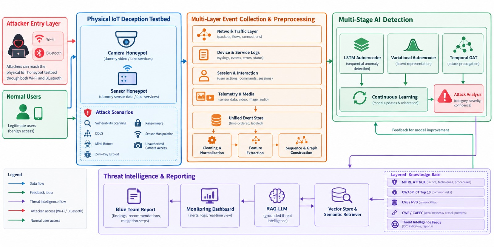

# AEGEX

AEGEX is the data pipeline, detection helper, threat-intelligence layer and dashboard backend for an **IoT honeypot system**. It turns sensor readings and honeypot events into labeled, stored, analysed data, and shows it on a live dashboard with a blue team report.



The project implements every block of the diagram **except the AI part** (LSTM autoencoder, variational autoencoder, temporal GAT, continuous learning, RAG-LLM). The hook where those would plug in is `aegex/detection/handoff.py`.

## What it does

1. **Simulates** an IoT deception testbed: a camera honeypot and a sensor honeypot, normal users, and attackers coming in over Wi-Fi or Bluetooth with seven attack scenarios. Your real ESP32 sensor CSV is the sensor data.
2. **Collects** events in four layers (network traffic, device and service logs, sessions and interaction, telemetry and media).
3. **Preprocesses** them: cleaning, normalisation, feature extraction, then sequence and graph construction.
4. **Analyses** each window with rule-based signatures (attack category, severity, confidence, MITRE techniques).
5. **Stores** results in PostgreSQL (structured), Elasticsearch (searchable events) and MinIO-compatible object storage (raw archive).
6. **Serves** a FastAPI backend and a dashboard, a searchable threat-intelligence knowledge base, and a downloadable **blue team report**.

## Quick start

```bash
# 1. put your sensor CSV in place
cp /path/to/your.csv data/my_data.csv

# 2. start everything
docker compose up -d --build

# 3. open the dashboard and the API docs
#    http://localhost:8000        dashboard
#    http://localhost:8000/docs   interactive API
```

The first start takes a few minutes while Elasticsearch becomes healthy. Full instructions, Windows/Mac/Linux notes and troubleshooting are in **[docs/SETUP.md](docs/SETUP.md)**.

## Documentation

| Document | What it covers |
|---|---|
| [docs/SETUP.md](docs/SETUP.md) | Prerequisites, step-by-step setup with Docker, running without Docker, CSV format, verifying, resetting, troubleshooting |
| [docs/CONFIGURATION.md](docs/CONFIGURATION.md) | Every `AEGEX_*` environment variable, default and meaning |
| [docs/ARCHITECTURE.md](docs/ARCHITECTURE.md) | Diagram-to-code status table, data flow, each pipeline stage in detail |
| [docs/DATA.md](docs/DATA.md) | Event types and fields, feature definitions, database tables, Elasticsearch indices, object storage layout, Kafka messages |
| [docs/API.md](docs/API.md) | Every HTTP endpoint with parameters and response shape |
| [docs/HONEYPOTS.md](docs/HONEYPOTS.md) | The Cowrie, Zeek and Mosquitto containers: how they connect to the pipeline, event mapping, limits, what was tested |
| [docs/FILES.md](docs/FILES.md) | What every file in the project does |
| [docs/DEVELOPMENT.md](docs/DEVELOPMENT.md) | Tests, extending the project (new scenario, real devices, the AI models), known limitations, production checklist |

## Project layout

```
AEGEX/
├── main.py                 pipeline entry point
├── docker-compose.yml      postgres, minio (SeaweedFS), elasticsearch, kafka, cowrie, mosquitto, zeek, pipeline, api
├── honeypots/              config for the real honeypot containers (mosquitto.conf, aegex.zeek)
├── Dockerfile, requirements.txt, .dockerignore, .gitignore
├── data/                   your sensor CSV (my_data.csv)
├── database/schema.sql     PostgreSQL tables
├── frontend/dashboard.html monitoring dashboard
├── docs/                   all documentation + the architecture diagram
├── tests/                  pytest suite
└── aegex/
    ├── config.py, models.py
    ├── testbed/            attacker entry layer, honeypots, 7 attack scenarios (simulated)
    ├── collection/         CSV reader + collector + real honeypot feeds (Cowrie, Zeek, Mosquitto)
    ├── processing/         cleaning, features, sequence and graph
    ├── storage/            PostgreSQL, Elasticsearch, MinIO
    ├── detection/          rule-based attack analysis + hook for the AI models
    ├── intel/              knowledge base, retriever, blue team report
    └── api/                FastAPI app and routes
```

## Status at a glance

| Diagram block | Status | Notes |
|---|---|---|
| Attacker entry layer (Wi-Fi, Bluetooth) | Simulated | Events are tagged `wifi` or `bluetooth`. There is no real radio interface. |
| Normal users | Simulated | Benign phone and dashboard traffic over both channels. |
| Camera and sensor honeypots | Simulated, plus real services | The simulator still tags camera/sensor events, and no physical camera runs. Real Cowrie (SSH/Telnet), Mosquitto (MQTT) and Zeek (network monitor) containers now feed real events in; see [docs/HONEYPOTS.md](docs/HONEYPOTS.md). Your ESP32 CSV is the real sensor data. |
| Attack scenarios (all 7) | Yes | Scanning, DDoS, Mirai, ransomware, sensor manipulation, unauthorized camera access and zero-day, each with its own event pattern. |
| Four collection layers | Mostly | Network, device logs, sessions and telemetry are all present. The media layer holds stream metadata (frame rate, bitrate, authenticated or not), not real video, image or audio files. |
| Unified event store | Mostly | Time-ordered and labeled, but spread across Elasticsearch, MinIO and Postgres rather than one store. |
| Cleaning, feature extraction, sequence and graph | Yes | All three steps are separate in the pipeline. |
| LSTM autoencoder, VAE, temporal GAT | Skipped |  The Kafka handoff is where they would plug in. |
| Continuous learning and feedback loop | Skipped | Part of the AI block. |
| Attack analysis (category, severity, confidence) | Yes, rule-based | Signature rules, not a model. |
| Layered knowledge base | Partly | All five layers exist, but as a small curated seed. The threat feeds are placeholder IPs, not live feeds. |
| Vector store and semantic retriever | Simplified | A keyword search, not embeddings. |
| RAG-LLM | Skipped | The report is template-based, but its findings are linked to knowledge-base entries. |
| Monitoring dashboard | Yes | Now shows layers, scenarios, detections, knowledge-base search and the report. |
| Blue team report | Yes | Findings, recommendations and mitigation steps, as JSON or a downloadable markdown file. |

## Important limits

- The attackers are **simulated**. The analyzer matching 100% of simulated attacks only shows the rules and the simulator agree; it says nothing about real attack traffic.
- Development defaults only: default passwords, Elasticsearch security off, CORS open to all origins, no dashboard login.
- Re-running `main.py` on the same CSV adds duplicate rows (batch ids are random per run).

See [docs/DEVELOPMENT.md](docs/DEVELOPMENT.md) for the full list.
