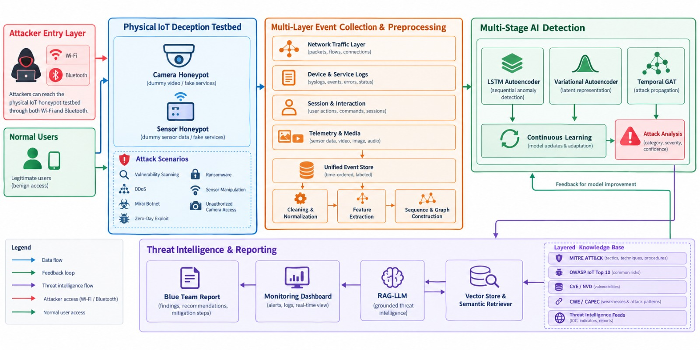

# Architecture



Each folder under `aegex/` follows one block of the diagram, left to right.

## 1. Status of every diagram block

| Diagram block | Status | Notes |
|---|---|---|
| Attacker entry layer (Wi-Fi, Bluetooth) | Simulated | Events are tagged `wifi` or `bluetooth`. There is no real radio interface. |
| Normal users | Simulated | Benign phone and dashboard traffic over both channels. |
| Camera and sensor honeypots | Simulated | Events are tagged by honeypot, but no physical devices or fake services run. Your ESP32 CSV is the real sensor data. |
| Attack scenarios (all 7) | Yes | Scanning, DDoS, Mirai, ransomware, sensor manipulation, unauthorized camera access and zero-day, each with its own event pattern. |
| Four collection layers | Mostly | Network, device logs, sessions and telemetry are all present. The media layer holds stream metadata (frame rate, bitrate, authenticated or not), not real video, image or audio files. |
| Unified event store | Mostly | Time-ordered and labeled, but spread across Elasticsearch, MinIO and Postgres rather than one store. |
| Cleaning, feature extraction, sequence and graph | Yes | All three steps are separate in the pipeline. |
| LSTM autoencoder, VAE, temporal GAT | Separate | Built in `ai-models/lstm-vae-gat/` (trained, benchmarked on 7 datasets, scores pcaps), not yet connected to this pipeline. The Kafka handoff is where they would plug in. |
| Continuous learning and feedback loop | Skipped | Part of the AI block. |
| Attack analysis (category, severity, confidence) | Yes, rule-based | Signature rules, not a model. |
| Layered knowledge base | Partly | All five layers exist, but as a small curated seed. The threat feeds are placeholder IPs, not live feeds. |
| Vector store and semantic retriever | Simplified | A keyword search, not embeddings. |
| RAG-LLM | Skipped | The report is template-based, but its findings are linked to knowledge-base entries. |
| Monitoring dashboard | Yes | Now shows layers, scenarios, detections, knowledge-base search and the report. |
| Blue team report | Yes | Findings, recommendations and mitigation steps, as JSON or a downloadable markdown file. |

## 2. Where each block lives in the code

| Diagram block | Code |
|---|---|
| Attacker entry layer, normal users, honeypots, attack scenarios | `aegex/testbed/simulator.py` |
| Multi-layer event collection | `aegex/collection/` (`csv_reader.py`, `collector.py`), layer names in `aegex/models.py` |
| Cleaning and normalisation, feature extraction | `aegex/processing/preprocessing.py` |
| Sequence and graph construction | `aegex/processing/sequence_graph.py` |
| Unified event store | `aegex/storage/` (`es_store.py`, `postgres_store.py`, `minio_store.py`) |
| Attack analysis | `aegex/detection/attack_analysis.py` |
| Hook for the AI models | `aegex/detection/handoff.py` (Kafka topics and webhooks) |
| Knowledge base, retriever, blue team report | `aegex/intel/` |
| Monitoring dashboard | `aegex/api/` and `frontend/dashboard.html` |

## 3. Data flow

```
data/my_data.csv ─► CSVSensorReader ─┐
                                      ├─► TelemetryCollector ─► TelemetryBatch (1 CSV row + all events of that moment)
HoneypotEventSimulator ──────────────┤
submit_event() (real sensors) ───────┘
                                              │
                                              ▼
                    PreprocessingPipeline  (aegex/processing/preprocessing.py)
         1 raw events ► 2 Cleaning ► 3 Normalisation ► 4 Feature extraction ► 5 Sequence & graph
                                                                   └► AttackAnalyzer (rule-based)
                                              │  FeatureVector (+ window, graph edges, analysis)
                  ┌───────────────┬───────────┴───────────┬──────────────────┐
                  ▼               ▼                       ▼                  ▼
             PostgreSQL     Elasticsearch              MinIO / S3        Kafka / webhooks
        sensor_readings    raw + security indices    raw CSV + NDJSON    detection layer
        feature_vectors    (labeled events)          event logs          (AI models go here)
        attack_analyses
                  │               │
                  └──────► FastAPI (aegex/api) ◄── intel/ (knowledge base, retriever, report)
                                   │
                                   ▼
                        frontend/dashboard.html
```

`main.py` runs this loop. For every batch the four sinks run **concurrently in worker threads and are isolated**: if one fails, the others still succeed and the failed payload is appended to the dead-letter file.

## 4. Stage details

### 4.1 Testbed (`aegex/testbed/simulator.py`)

`HoneypotEventSimulator.generate_window(ts)` produces the events for one moment (one CSV row).

- **Attack:** with probability `AEGEX_ATTACK_PROB` (default 15%) one scenario is chosen uniformly from the seven.
- **Normal users:** 0 to 3 benign visitors from four private IPs, each with network traffic, a packet record, a device interaction, an MQTT publish, optionally a BLE scan (25% use Bluetooth), camera media metadata (when the camera is the target), and a 30% chance of a short HTTP session.
- **Device syslog:** a 50% chance of one `info` log line from a random honeypot.
- **Tagging:** every event gets `label` (`benign` or the scenario), `actor` (`attacker` or `normal_user`), `entry_vector` (`wifi` or `bluetooth`) and `honeypot` (`sensor_honeypot` or `camera_honeypot`). This is what makes the event store labeled.

The two honeypots are `smoke_detector` (sensor honeypot) and `ip_camera` (camera honeypot). Attackers come from five fixed documentation-range IPs (`203.0.113.45`, `198.51.100.23`, `192.0.2.77`, `203.0.113.150`, `198.51.100.200`).

| Scenario | Entry | Target | What the events show |
|---|---|---|---|
| `vulnerability_scanning` | Wi-Fi (2/3) or Bluetooth (1/3) | random | one source touches 7 to 12 different ports with tiny packets (40 to 120 bytes), SYN-only probe packet, a "probe on /admin" warning log, optional `/etc/passwd` path-traversal request, BLE scan if Bluetooth |
| `ddos` | Wi-Fi | random | 2 to 4 sources send 300 KB to 2 MB and 800 to 5000 packets each, 1500-byte SYN packets, "connection queue full" error log, "cpu load 98%" critical log |
| `mirai_botnet` | Wi-Fi | random | 4 to 12 failed Telnet or SSH logins with default credentials, traffic to port 23, a `wget ... mirai.sh` dropper command piped into a shell plus another bad command, "new process /tmp/.x" log |
| `ransomware` | Wi-Fi | random | 1 to 3 failed SSH logins then a successful root login, 2 to 4 commands such as `openssl enc ... .locked`, `rm -rf /data/backups`, a ransom-note write; config change, "write storm ... .locked" log, high-entropy packet |
| `sensor_manipulation` | Wi-Fi or Bluetooth | smoke detector | spoofed MQTT publish to `home/smoke/telemetry`, alarm config change, traffic to port 1883, "alarm threshold modified" log, BLE `gatt_write` if Bluetooth |
| `unauthorized_camera_access` | Wi-Fi (2/3) or Bluetooth (1/3) | IP camera | 1 to 3 failed HTTP logins, RTSP traffic on port 554, a stream request, an unauthenticated media stream, `GET /snapshot.jpg`, "stream opened without credentials" log, BLE `pair_attempt` if Bluetooth |
| `zero_day_exploit` | Wi-Fi | random | oversized request with a 64-byte filler and `%n%n`, high-entropy payload (7.6 to 7.99), "segfault at 0x41414141" critical log, firmware download attempt |

Real devices replace the simulator by calling `TelemetryCollector.submit_event(event_type, payload, source)`. Those events join the next batch.

### 4.2 Collection (`aegex/collection/`)

- `CSVSensorReader.stream()` reads the file line by line, detects the delimiter, maps header aliases, flags rows with the wrong field count (`_malformed`), and sleeps for the gap between consecutive `esp_ms` values (divided by `AEGEX_REPLAY_SPEED`, at most `AEGEX_MAX_SLEEP`). It can keep tailing a growing file (`AEGEX_FOLLOW_CSV`) and waits for half-written lines.
- `TelemetryCollector.stream_batches()` wraps each row as a `sensor_reading` event, adds the simulated window and any externally pushed events, and yields a `TelemetryBatch`. Nothing is cleaned here; values stay as raw strings.

The four **collection layers** are derived from the event type (`LAYER_OF` in `models.py`):

| Layer | Event types |
|---|---|
| `network_traffic` | `network_traffic`, `packet_characteristics`, `source_ip` |
| `device_service_logs` | `device_log`, `mqtt_event`, `ble_event` |
| `session_interaction` | `login_attempt`, `failed_login`, `session_info`, `command_request`, `device_interaction` |
| `telemetry_media` | `sensor_reading`, `media_telemetry` |

### 4.3 Preprocessing (`aegex/processing/preprocessing.py`)

**Cleaning (`Cleaner`)**
- Sensor values are converted to numbers (a comma decimal is accepted). Values that are missing, not finite or outside the valid range are replaced by the **last valid value** of that field (forward fill). Before any valid reading exists, defaults are used (smoke 0, temperature 25 °C, humidity 50 %).
- A row is **dropped** only when all three sensor fields are invalid and there is no earlier valid data.
- `was_imputed` marks rows where anything was replaced or the row was malformed. `quality.issues` lists what happened (for example `smoke:out_of_range`).
- Events with an unknown type or an invalid `src_ip` are dropped and counted in `quality.dropped_events`. Numeric event fields that are negative or not numbers become `null`.

**Normalisation (`Normalizer`)**
- Sensor values: min-max over **fixed physical ranges**, not over the data, so there is no leakage and a value always maps the same way.
- Packet size: log scale with a ceiling of 65535. Session duration: log scale, ceiling 3600 s. Login counts: divided by 50, capped at 1.

**Feature extraction (`FeatureExtractor`)** builds the 8-number vector (`FEATURE_ORDER`): `smoke`, `tempeture`, `humidity_pct`, `network_packet_size`, `login_attempts`, `session_duration`, `ip_reputation_score`, `failed_logins`. Definitions are in [DATA.md](DATA.md). If a window contains **no network events at all**, the network features are replaced with deterministic mock values and the vector is marked `feature_source = "mock"`; otherwise `"observed"`.

**IP reputation (`IPReputation`)**: 0.90 to 0.99 for addresses on the blocklist, 0.02 for private ranges, 0.05 to 0.34 (a stable hash-based pseudo-score) for other public addresses. Replace `score()` with a real lookup (AbuseIPDB or similar) for production.

**Sequence and graph (`aegex/processing/sequence_graph.py`)**
- *Sequence:* the last `AEGEX_WINDOW_SIZE` (20) feature vectors, oldest first.
- *Graph:* one edge per (source IP, target device) with `count` (events) and `failed` (failed logins). The target is the event's `device`, or `AEGEX_DEVICE_ID` if none.

### 4.4 Attack analysis (`aegex/detection/attack_analysis.py`)

Rule-based, no machine learning. For each batch, every scenario has four **signals**. A "bad source" is an IP with reputation of 0.5 or more (that means: on the blocklist).

| Scenario | Signals (all four are checked) |
|---|---|
| `vulnerability_scanning` | `many_ports_probed` (one IP touched 6 or more ports with under 200 bytes each), `syn_probe_packets` (flags exactly `S`, size 100 or less), `probe_in_device_log`, `known_bad_source` |
| `ddos` | `flood_volume` (an event with 800 or more packets or 300,000 or more bytes), `multiple_sources` (2 or more flooding IPs), `service_degradation_log` (queue full, dropping, cpu load, watchdog), `syn_flood_packets` (flags `S`, size 1000 or more) |
| `mirai_botnet` | `repeated_failed_logins` (4 or more), `telnet_or_ssh_bruteforce`, `dropper_command` (wget, curl, busybox, mirai, nc -e, chmod 777, tftp), `known_bad_source` |
| `ransomware` | `encryption_or_ransom_command` (encrypt, .locked, ransom, openssl enc, rm -rf /data), `successful_root_login`, `config_change` from a bad source, `storage_write_storm_log` |
| `sensor_manipulation` | `mqtt_publish_from_bad_source` (topic contains "smoke"), `alarm_config_change` on the smoke detector from a bad source, `ble_gatt_write`, `threshold_modified_log` |
| `unauthorized_camera_access` | `camera_access_from_bad_source`, `unauthenticated_media_stream`, `rtsp_port_from_bad_source` (port 554), `snapshot_request` from a bad source |
| `zero_day_exploit` | `crash_in_device_log` (segfault, crash, overflow, core dumped), `high_entropy_payload` (7.5 or more), `firmware_download_from_bad_source`, `oversized_command` (64 or more characters) |

How the result is chosen:
1. A scenario needs **at least 2 signals**. Among those, the one with the highest share of fired signals wins (ties go to the larger number of signals).
2. `confidence = min(0.99, 0.3 + 0.7 × share)`.
3. `severity` is the scenario's base severity: scanning `low`, DDoS `high`, Mirai `high`, ransomware `critical`, sensor manipulation `high`, camera access `high`, zero-day `critical`. A `low` result with confidence 0.9 or more becomes `medium`.
4. `src_ips` are the bad sources; `entry_vector`, `honeypot` and `ground_truth` are read from the tags on the events of those sources (`ground_truth` is the simulator label and is only for evaluation). `mitre` lists the technique IDs of the scenario.
5. If fewer than 2 signals fire, the batch has no analysis (`null`).

The simulator and these rules were written together, so a 100% match on simulated data proves consistency, not real-world accuracy. Several signals depend on the attacker IP being on the blocklist; an unknown attacker would trigger fewer of them.

### 4.5 Storage (`aegex/storage/`)

| Store | Holds | Why |
|---|---|---|
| PostgreSQL | cleaned sensor rows, feature vectors, attack analyses | structured, queryable, drives time-series charts and the report |
| Elasticsearch | every event, plus a "security" copy of events above `info` | fast search, filtering and aggregations for the dashboard |
| MinIO-compatible object store | the raw CSV and NDJSON logs of every raw event | cheap long-term archive; with Object Lock, objects cannot be changed or deleted during the retention period |

Elasticsearch classifies each event with `classify()` (rules in [DATA.md](DATA.md)). Writes to Postgres are idempotent per `batch_id`; Elasticsearch documents use `event_id` as `_id`.

### 4.6 Detection hook (`aegex/detection/handoff.py`)

When enabled, each processed batch is published to Kafka (`aegex.detection.features` with vector, window and attack analysis; `aegex.detection.graph` with edges) and optionally POSTed to webhook URLs. Future LSTM/VAE/GAT consumers read these topics. Delivery failures are logged and never stop the pipeline.

### 4.7 Threat intelligence (`aegex/intel/`)

- `knowledge_base.py`: five layers (MITRE ATT&CK, OWASP IoT Top 10, CVE/NVD, CWE/CAPEC, threat feeds) as `KBEntry` records, plus `CATEGORY_PROFILE` linking every attack scenario to its techniques, risks, weaknesses, severity and mitigation steps.
- `retriever.py`: keyword search (TF-IDF style scoring over id, title, tags and description) with an optional layer filter.
- `report.py`: groups stored attack analyses by scenario and builds findings (counts, severity, time span, top sources, entry vectors, targets, evidence signals, references, mitigations) and a de-duplicated, priority-ordered recommendation list, as JSON or markdown.

### 4.8 API and dashboard (`aegex/api/`, `frontend/dashboard.html`)

FastAPI serves JSON under `/api/v1/...`, the dashboard at `/` and Swagger at `/docs`. The dashboard is a single static page (Chart.js from a CDN) that polls the API. It shows: service status, three sensor charts with KPIs, four collection-layer cards plus entry-vector and actor cards, the detected-scenario chart, a recent-detections table, a security-event histogram and table, a threat-intelligence search box, and a blue team report viewer with a markdown download. See [API.md](API.md).
